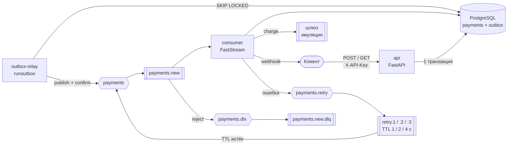
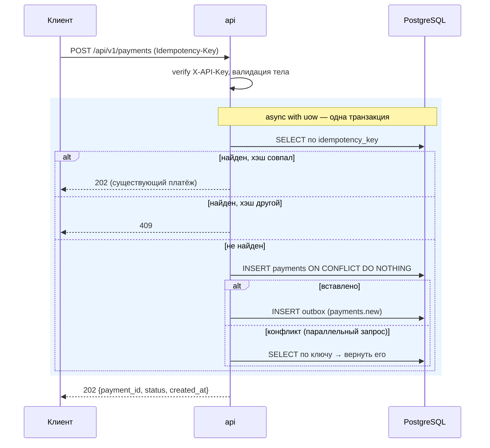
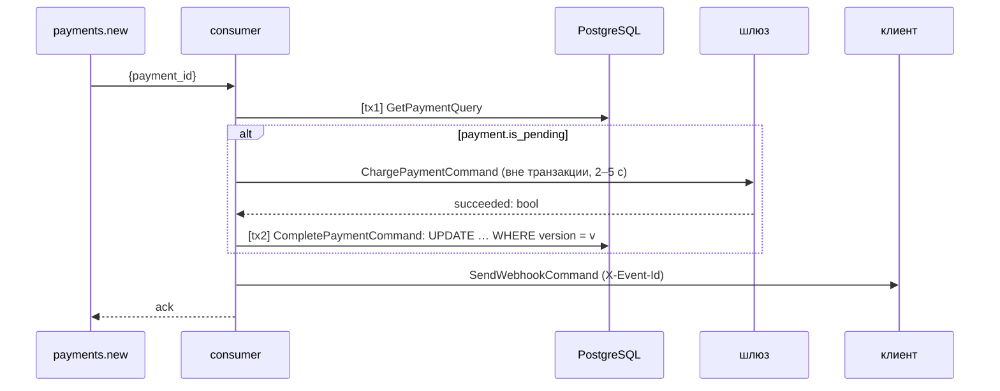

# Архитектура Payments Service

Технический документ: как устроен сервис, где проходят границы транзакций, какие гарантии он даёт и почему. Обзор, запуск и примеры — в [README](../README.md), проверка — в [TESTING](TESTING.md).

## 1. Контекст

Сервис принимает платёж по HTTP, асинхронно проводит его через платёжный шлюз (эмуляция: 2–5 с, 90 % успеха) и уведомляет клиента webhook'ом.

Требования, которые определили архитектуру:
- событие о платеже **не теряется** между БД и брокером;
- повторный запрос клиента **не создаёт** второй платёж;
- сбой доставки webhook'а **повторяется** с экспоненциальной задержкой, затем — DLQ;
- любой компонент можно перезапустить или запустить в нескольких экземплярах без порчи данных.

## 2. Компоненты



| Процесс | Команда | Масштабирование |
|---|---|---|
| `api` | `uvicorn app.api.main:create_app --factory` | stateless, любое число реплик |
| `consumer` | `faststream run app.consumer.main:create_app --factory` | реплики делят очередь (`prefetch_count=10` на каждую) |
| `outbox-relay` | `python -m app.manage runoutbox` | реплики делят строки outbox (`SKIP LOCKED`) |
| `migrate` | `alembic upgrade head` | one-shot, остальные стартуют после его успеха |

Все процессы — один образ и один граф зависимостей (`app/ioc.py`); отличается только точка входа.

## 3. Слои и правило зависимостей

```
api/ · consumer/ · manage.py        точки входа: транспорт, границы транзакций
        │
application/                        команды, запросы, хендлеры, медиатор
        │
domain/                             сущность Payment, события, правила переходов
        ▲
infra/                              ORM, репозитории, UoW, брокер, шлюз, webhook
```

- **domain** не импортирует ничего из других слоёв.
- **application** использует домен и конкретные классы infra напрямую — без Protocol/ABC-интерфейсов. Это сознательное упрощение под размер задачи (одна реализация каждого порта); в продакшене здесь были бы порты — см. [§3.1](#31-что-упрощено-относительно-полного-cqrs).
- **точки входа** знают только `UnitOfWork`, `Mediator` и типы команд.

### Домен

`Payment` (`app/domain/payment.py`) — dataclass-сущность:
- `create(...)` валидирует сумму (`> 0`), округляет до копеек и регистрирует событие `PaymentCreatedEvent` (`event_name = "payments.new"` — он же routing key);
- `mark_succeeded()` / `mark_failed()` разрешены только из `pending`, иначе `InvalidStatusTransition`;
- `is_pending` — вопрос, который задаёт consumer, вместо собственной логики;
- `version` — счётчик для optimistic lock;
- `to_dict()` — состояние для хранения, ключи совпадают с колонками таблицы (проверяется тестом).

Статусов три, как в ТЗ: `pending → succeeded | failed`. Обратных переходов нет.

### Application (CQRS-lite)

| Запрос | Тип | Что делает |
|---|---|---|
| `CreatePaymentCommand` | command → `Payment` | идемпотентное создание + событие в outbox |
| `GetPaymentQuery` | query → `Payment` | чтение, `PaymentNotFound` если нет |
| `ChargePaymentCommand` | command → `bool` | вызов шлюза; БД не трогает |
| `CompletePaymentCommand` | command → `Payment` | запись результата с optimistic lock |
| `SendWebhookCommand` | command → `None` | доставка webhook'а |
| `PublishOutboxCommand` | command → `bool` (has_more) | пачка outbox → RabbitMQ |

**Медиатор** (`app/application/mediator.py`) — реестр `тип запроса → тип хендлера` (`registry.HANDLERS`). Хендлер резолвится из DI-контейнера **текущего скоупа**, поэтому все хендлеры одного запроса/сообщения работают на одной сессии БД. Разделение `send(Command[R])` / `query(Query[R])` делает CQRS видимым в API, а дженерик `R` даёт типизированный результат. Регистрация декораторами, автоскан и pipeline behaviors — точки роста, не нужные при шести хендлерах.

### Infra: CQRS на уровне репозиториев

На сущность — пара репозиториев на **одной сессии**:

| Репозиторий | Методы |
|---|---|
| `PaymentQueryRepository` | `get`, `get_by_idempotency_key` |
| `PaymentCommandRepository` | `add` (`ON CONFLICT DO NOTHING` → `bool`), `update` (optimistic lock, белый список полей) |
| `OutboxQueryRepository` | `fetch_for_update(limit, max_attempts)` — `FOR UPDATE SKIP LOCKED` |
| `OutboxCommandRepository` | `add_events`, `delete`, `record_failures` |

Модель данных одна (`PaymentModel.to_entity()`), отдельных read-моделей нет — один источник правды. Репозитории отдают доменные сущности, ORM-объекты наружу не выходят.

### 3.1 Что упрощено относительно полного CQRS

Реализация — **CQRS-lite**: разделены команды и запросы, хендлеры и репозитории чтения / записи. Но обе стороны работают с одной моделью и одной БД, а application зависит от конкретных классов infra. Для одной сущности и шести хендлеров слой абстракций был бы оверхедом без пользы, поэтому его нет. В продакшен-сервисе абстракций было бы больше:

| Сейчас | В продакшене | Что даёт |
|---|---|---|
| хендлеры зависят от `PaymentQueryRepository`, `PaymentGateway`, `WebhookSender`, `RabbitBroker` напрямую | **порты** (Protocol/ABC) в application, реализации в infra; DI связывает порт с реализацией | инверсия зависимостей; unit-тесты хендлеров с in-memory реализациями, без testcontainers; замена шлюза / брокера без правки application |
| `UnitOfWork` — конкретный класс над `AsyncSession` | абстрактный UoW (порт) с реализацией на SQLAlchemy | application не знает о SQLAlchemy |
| query-сторона возвращает доменную сущность `Payment` | **read-модели** / проекции под конкретные запросы; при нагрузке — реплика или отдельное хранилище, обновляемое событиями | чтение не тянет доменную модель, масштабируется отдельно от записи |
| хендлеры — простые dataclass'ы с `handle` | базовые `CommandHandler[C, R]` / `QueryHandler[Q, R]`, регистрация декораторами / автоскан | единый контракт, статическая проверка соответствия команды и хендлера |
| медиатор без pipeline | **behaviors**: логирование с корреляцией, метрики, валидация, ретраи | сквозная функциональность в одном месте |
| примитивы `Decimal`, `str` | **value objects** `Money`, `IdempotencyKey`, `WebhookUrl` | инварианты в типах, а не в проверках |
| одно событие `PaymentCreatedEvent` как контракт очереди | разделение **доменных** и **интеграционных** событий, версионирование схем | эволюция внутренней модели не ломает потребителей |

## 4. Данные

```
payments                                   outbox
──────────────────────────────────         ──────────────────────────────
id               uuid PK                   id           uuid PK  (= event_id = message_id)
amount           numeric(18,2)             event_type   varchar  (= routing key)
currency         varchar                   payload      jsonb
description      varchar                   created_at   timestamptz
metadata         jsonb                     attempts     int      (отказы брокера)
status           varchar                   last_error   varchar
idempotency_key  varchar UNIQUE
request_hash     varchar  (blake2b тела)
webhook_url      varchar
created_at       timestamptz
processed_at     timestamptz NULL
version          bigint   (optimistic lock)
```

- Ограничения длины и допустимые значения проверяет Pydantic на входе; в БД — только то, что защищает целостность (`PK`, `UNIQUE`, `NOT NULL`). Значения по умолчанию ставит код, не БД.
- Отправленные события **удаляются** из outbox — таблица остаётся маленькой, индекс неотправленных не нужен.
- Миграции: `0001_init`, `0002_outbox_attempts` (генерация `alembic --autogenerate` с ручной правкой; `NOT NULL`-колонка на непустой таблице добавляется через временный `server_default`). Integration-тест сверяет миграции с моделями.

## 5. Топология RabbitMQ

| Объект | Тип | Аргументы |
|---|---|---|
| `payments` | direct exchange, durable | — |
| `payments.new` | queue, durable, rk `payments.new` | DLX `payments.dlx`, DL-rk `payments.new.dlq` |
| `payments.retry` | direct exchange, durable | — |
| `payments.new.retry.N` (N=1..3) | queue без consumer'ов, rk `retry.N` | `x-message-ttl = base·2^(N−1)`, DLX `payments` → rk `payments.new` |
| `payments.dlx` | direct exchange, durable | — |
| `payments.new.dlq` | queue, durable | — |

- **Своя очередь на каждую попытку** с TTL на уровне очереди: при per-message `expiration` в одной общей очереди сообщения истекают только из головы (head-of-line блокировка).
- Топологию объявляют **и consumer, и relay** при старте (`declare_topology`): subscriber объявляет только свою очередь, а relay может стартовать первым — тогда публикация ушла бы в exchange без привязанной очереди.
- Аргументы очереди фиксируются при первом declare; повторный declare с другими значениями → `PRECONDITION_FAILED`. Поэтому после смены `MAX_RETRIES` / `RETRY_BASE_DELAY` retry-очереди нужно удалить.

## 6. Потоки

### 6.1 Создание платежа



`ON CONFLICT DO NOTHING` в READ COMMITTED ждёт коммита конкурирующей транзакции; следующий `SELECT` уже видит её строку — гонка двух одинаковых запросов даёт одну запись.

### 6.2 Публикация (outbox relay)

```
BEGIN
  SELECT … FROM outbox WHERE attempts < N ORDER BY created_at LIMIT 1000 FOR UPDATE SKIP LOCKED
  publish × 1000 (до 100 параллельно), каждое ждёт publisher confirm
  DELETE успешных; attempts += 1 у отклонённых брокером
COMMIT
```

Опубликовать и удалить атомарно нельзя (две системы), поэтому порядок «сначала publish, потом delete»: сбой между ними → повторная публикация, но не потеря.

### 6.3 Обработка (consumer)



Шлюз вызывается **между** транзакциями: держать соединение 2–5 с на каждое из 10 параллельных сообщений — исчерпать пул; к тому же откат транзакции не отменил бы списание. Одна сессия на сообщение (REQUEST-скоуп), повторный `async with uow:` — новая транзакция.

### 6.4 Retry и DLQ

`RetryMiddleware` (`app/consumer/retry.py`) оборачивает хендлер. Это FastStream middleware, а не декоратор: декоратору пришлось бы менять сигнатуру хендлера (нужны сообщение и брокер), что ломает разбор параметров FastStream и dishka. `AcknowledgementMiddleware` FastStream всегда снаружи пользовательских, поэтому `RejectMessage` отсюда превращается в reject → DLX.

| Исход хендлера | Действие |
|---|---|
| успех | ack |
| `PaymentNotFound`, `ValidationError` | reject → DLQ сразу (повтор не поможет) |
| иная ошибка, `x-retry-count < MAX_RETRIES` | копия в `payments.retry` с `x-retry-count+1`, тем же `message_id`; ack оригинала |
| иная ошибка, попытки исчерпаны | reject → DLQ |
| не удалось опубликовать в retry | nack с requeue — временный сбой брокера не отправляет в DLQ |

«3 попытки» = исходная обработка + 3 повтора (1 / 2 / 4 с), затем DLQ. Ошибка шлюза (10 %) — бизнес-результат (`failed` + webhook), а не повод для retry.

## 7. Гарантии и идемпотентность

Доставка на всём пути — **at-least-once**. Каждый шаг безопасен при повторе:

| Повтор | Механизм |
|---|---|
| клиент повторил POST | `idempotency_key UNIQUE` + сравнение `request_hash` |
| два одинаковых POST одновременно | `ON CONFLICT DO NOTHING` + перечитывание |
| relay опубликовал дважды (сбой до commit) | consumer идемпотентен (ниже) |
| сообщение доставлено повторно | `is_pending == False` → шлюз не вызывается |
| два consumer'а на одном сообщении | optimistic lock: второй `UPDATE` → 0 строк → `ConcurrentUpdateError` → перечитать результат первого |
| повторный вызов шлюза | шлюз идемпотентен по `payment_id` (исход детерминирован хэшем id) |
| повторный webhook | `X-Event-Id` — получатель отсекает дубли |

Надёжная публикация требует трёх условий одновременно: `persist=True` (сообщение переживает рестарт брокера), publisher confirms (`publish` ждёт подтверждения) и `on_return_raises=True` (сообщение без маршрута — ошибка; по умолчанию FastStream считает такую публикацию успешной — проверено на RabbitMQ).

## 8. Отказы

| Что упало | Поведение |
|---|---|
| RabbitMQ | API принимает платежи (outbox копится); relay логирует ошибку и делает паузу `OUTBOX_POLL_INTERVAL` без горячего цикла и без роста `attempts`; consumer переподключается сам (robust connection) |
| consumer | события копятся в `payments.new`; после старта обрабатываются |
| relay | события копятся в outbox; после старта публикуются |
| PostgreSQL | API отвечает 500; consumer — ошибка → retry → при затяжном простое DLQ |
| получатель webhook | retry 1/2/4 с → DLQ; статус платежа уже сохранён |
| сообщение отвергнуто брокером (нет маршрута) | `outbox.attempts += 1`; после `OUTBOX_MAX_ATTEMPTS` строка не выбирается (карантин с `last_error`), не блокирует новые события |
| SIGTERM любому процессу | текущая пачка / сообщение доводится до конца, ресурсы закрываются; команды в exec-форме, процесс — PID 1 |

## 9. Dependency Injection

`app/ioc.py`, библиотека dishka:

| Скоуп | Зависимости |
|---|---|
| APP | `Settings`, `RabbitBroker` (из контекста), `AsyncEngine` (→ dispose), `async_sessionmaker`, `httpx.AsyncClient` (→ aclose), `PaymentGateway`, `WebhookSender` |
| REQUEST (HTTP-запрос / сообщение / итерация relay) | `AsyncSession` (→ close), `UnitOfWork`, все репозитории, хендлеры, `Mediator` |

`make_container(settings, *providers, broker=None)` — единственная точка сборки; тесты подменяют шлюз провайдером с `override=True`. Брокер создаёт точка входа: consumer'у он нужен до старта контейнера для регистрации subscriber'а.

`UnitOfWork` — только граница транзакции (commit / rollback) над сессией скоупа, без ContextVar: сессия передаётся явно через конструкторы, транзакцию открывает точка входа.

## 10. Решения и компромиссы

| Решение | Альтернатива | Почему так |
|---|---|---|
| Outbox + отдельный relay | публикация в брокер из API | атомарность платежа и события без 2PC |
| Удаление отправленных строк | флаг `published_at` | маленькая таблица, без индекса и cron-очистки |
| Optimistic lock | `SELECT … FOR UPDATE` / advisory lock | конфликт редкий (дубль сообщения), блокировка не держится во время шлюза |
| TTL-очередь на попытку | delayed-message plugin / `expiration` | стандартный RabbitMQ без плагинов, без head-of-line блокировки |
| Шлюз идемпотентен по id | статус `processing` + сверка | в ТЗ три статуса; так устроены ключи идемпотентности реальных шлюзов |
| Webhook at-least-once | поле `webhook_sent_at` | дубли отсекает получатель, нет третьей транзакции |
| dishka | `FastAPI Depends` + ручная сборка | три точки входа на одном графе, async-финализация ресурсов |
| Минимальный медиатор | декораторная регистрация | явный словарь нагляднее при шести хендлерах |
| CQRS-lite без портов | полный CQRS с портами и read-моделями | одна сущность, одна реализация каждого порта — слой абстракций не окупится ([§3.1](#31-что-упрощено-относительно-полного-cqrs)) |
| `X-API-Key` на всех эндпоинтах API, Swagger открыт | закрыть документацию ключом / Basic / query-параметром | браузер не шлёт заголовок при загрузке схемы — закрытый Swagger не откроется; запросы из него идут с ключом через Authorize; в проде — `API_DOCS_ENABLED=false` |

## 11. Что изменилось бы в продакшене

- **Абстракции:** порты, read-модели, базовые хендлеры, behaviors, value objects — см. [§3.1](#31-что-упрощено-относительно-полного-cqrs).
- **Реальный шлюз:** статус `processing` до вызова, webhook шлюза только как сигнал + `GET` для подтверждения, периодическая сверка зависших платежей.
- **Наблюдаемость:** структурные логи с `payment_id` / `message_id`, метрики (размер outbox, глубина очередей, число retry/DLQ), трейсинг через границу HTTP → outbox → RabbitMQ.
- **Безопасность:** подпись webhook'ов (HMAC), секреты из secret store, ключи API на клиента.
- **Эксплуатация:** инструмент переотправки из DLQ и из карантина outbox; partitioning / архивирование `payments`.
